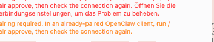
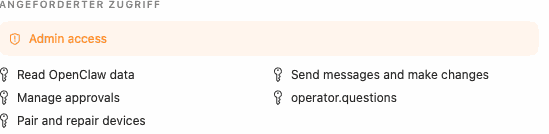
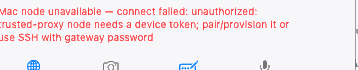

# Native macOS app E2E: real UI access and separate node denial

Evidence date: 17 November 2026 (CST, UTC+08:00). Draft PR openclaw/openclaw#200178.

## Versions and provenance

- Gateway: forked OpenClaw 2026.11.4, PR code HEAD fae22bedc776fadbbbcfb7b0e8d2226d0b1969f6 (auth code unchanged since live-tested e0b9b754).
- Actual macOS graphical app: OpenClaw 2026.10.10, installed on a remote MacBook Air. This is an older app than the forked Gateway.
- Real network route: managed Tailscale Serve, with the Gateway using the isolated test state and mixed trusted-proxy/Tailscale policy.
- Sources: user-submitted actual macOS app screenshots, corroborated by on-host Gateway WebSocket event logs and an isolated device-list inspection.

## Confirmed actual app E2E

| Scenario | Actual observation and source | Interpretation |
| --- | --- | --- |
| Native operator UI before pairing | Menubar and Connection pane show Pairing required | Correct approval gate reached; no missing Cloudflare identity header at this stage |
| Operator pairing and approval | Gateway approved the signed macOS UI device. A separate graphical dialog requested Admin access/operator permissions | Operator approval, not a node grant |
| Native operator UI after pairing | Connection pane green, 377-380 ms, Remote gateway ready | Real graphical app successfully connected as an operator UI |
| Gateway log at 17:05:53.582 +08:00 | client=openclaw-macos, mode=ui, role=operator, auth=tailscale, connected | Real native UI authenticated over managed Tailscale Serve |
| Gateway log at 17:06:09.114 and 17:11:54.182 +08:00 | client=openclaw-macos, mode=ui, role=operator, auth=trusted-proxy, connected | Real native UI also authenticated via trusted-proxy path |
| Native Mac node | Menubar displays Mac node unavailable / unauthorized / trusted-proxy node needs a device token | A separate native node role was NOT successfully authenticated |
| Gateway node rejection | role=node, auth=none, signed device identity present, missing required proxy header, unauthorized | Correct negative boundary: operator/Tailscale identity is not upgraded to node rights |
| Gateway device list | Three paired operator-only devices (Control UI, macOS UI, CLI), zero node-role grants and no pending node pairing | Node bootstrap/role provisioning is separate |
| Native gateway list | Gateway connected but not paired as a node | Independent UI observation of missing node enrollment |
| UI page | Control UI Model Setup page loads | UI accessibility corroborated |

## Interpretation / remaining evidence gaps

This closes the specific gap of whether a real graphical macOS app can complete the operator UI handshake with the fix: yes, it can. The positive real application evidence is stronger than the earlier synthetic protocol client test.

It does NOT prove an authenticated native node connection. The node remains intentionally rejected without its own role-scoped token. It also does NOT verify the NEW native recovery dialogs in the 2026.11.4 source because the installed app is 2026.10.10.

The operator access dialog requested Admin access; this is not a node-specific permission grant. Repeated operator approvals do not provision a node token.

The isolated Gateway and credential stores were not modified for this report. No device identifiers, private hostname, personal IP, JWT, gateway password, raw log lines, or tokens are published.

## Screenshot provenance and redaction

Six user-supplied graphical evidence states were examined and cropped into privacy-redacted excerpts: (1) native pairing required, (2) native UI connected/ready, (3) operator Admin access approval dialog, (4) Mac node unauthorized, (5) connected Gateway but unpaired Node, and (6) Control UI opened. Only private hostnames, addresses, and identifiers are masked; observations were not fabricated. The full raw captures remain in the private conversation, not in GitHub.

The six privacy-redacted screenshot excerpts have now been uploaded as real PNG files. Each is cropped directly from the user's actual app screenshot; the full private source screenshots remain only in the conversation. The excerpts are grouped below by the observed result:

| Exhibit | Privacy-redacted actual screenshot |
| --- | --- |
| Before: macOS pairing required |  |
| After: native UI connected |  |
| After: native Gateway ready |  |
| Operator-only Admin access prompt |  |
| Mac node rejected: no device token |  |
| Gateway connected but node unpaired |  |

**Important:** Positive operator UI admission and negative node-role denial are two distinct results. No screenshot from the newer 2026.11.4 macOS app build is claimed, and no screenshot demonstrates successful native node enrollment.

## Subsequent matching-build 2026.11.4 transport E2E

**Update after the older-app test above:** The actual macOS app was built from the matching PR commit fae22bedc and tested via both SSH and Tailscale Direct.

- **Operator UI / Tailscale Direct: PASS.** Real app shows Connected via paired device, authenticating with its stored operator device token; WS receipt 21:50:49.868 +08:00 has role=operator, auth=device-token, connected.
- **Native Mac node / SSH: PASS.** Real version 2026.11.4 node appears paired and connected; WS receipt 21:44:22.351 +08:00 has role=node, auth=password, connected.
- **Same native Mac node / Tailscale Direct: NOT PASSED.** After returning from SSH, WS attempts at 21:50:53/56/59 +08:00 have role=node, auth=none, missing trusted-proxy identity header, unauthorized. Isolated node inventory now reports paired=true, connected=false.
- **Remaining:** Provision a properly scoped node credential for the direct endpoint and verify complete native recovery UX. The 2026.11.4 native app displays the missing-node-token error, but a complete successful repair workflow was not demonstrated.

See [separate matching-build SSH vs Direct report](transport-comparison.md) and [structured redacted log evidence](transport-comparison.json). Existing screenshots above document the earlier 2026.10.10 app, not this later matching-build test.

## Direct node after manual provisioning — positive matching-build E2E

**Follow-up after the negative Direct test:** Once the already-approved Node device token was explicitly associated with the verified Direct route using the OpenClawKit credential API, the actual macOS 2026.11.4 Node connected over Tailscale Direct with `auth=device-token` at **22:50:19.573** and **22:51:17.600** (after app restart), UTC+08:00.

The Gateway showed `paired=true`, `connected=true`, 10 capabilities and 22 advertised commands. Neither Gateway policy nor device grants were modified. **Manual provisioning is not proof of automatic first-run pairing or the complete native recovery UX.**

Read the [positive Node E2E report](direct-node-provisioned-20261117.md) and [sanitized WS results](direct-node-provisioned-20261117.json). Earlier failed Direct observations remain true for the pre-provisioned state.

## Responsible next steps

- Do not enable ambient Tailscale user identity as node authorization.
- Define and verify the supported native node bootstrap and automatic route-scoped token onboarding. The one-off, manually provisioned positive test does not establish a general self-service flow.
- The matching macOS app is now built and E2E-tested, but the full native recovery UI remains to be verified. Do not build on production VPN/Passwall hosts.
- After device-role approval, separately approve only the node capabilities required for testing.
